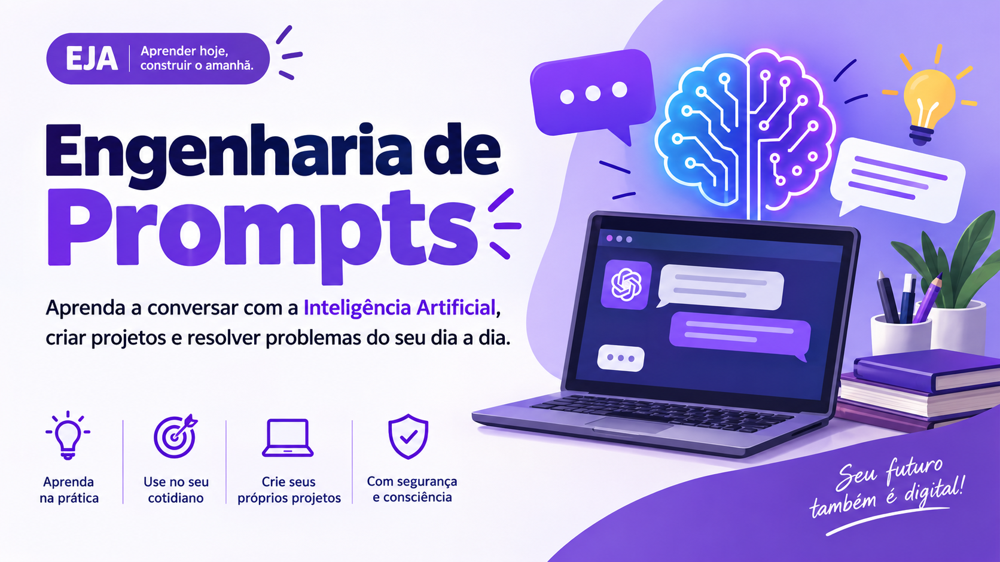

<p align="center">
  
</p>

> **Aprenda a conversar com a Inteligência Artificial, criar projetos e resolver problemas do cotidiano.**
>
> Este material foi desenvolvido para estudantes da Educação de Jovens e Adultos (EJA), com exemplos relacionados ao trabalho, aos estudos, à organização pessoal e à criação de projetos digitais.
>
> **Professor:** [Alan Santos Nunes — LinkedIn](https://www.linkedin.com/in/alan-sn/)

---

## 📚 Sumário

- [1. Introdução à Inteligência Artificial](#1--introdução-à-inteligência-artificial)
- [2. O que é Engenharia de Prompts?](#2--o-que-é-engenharia-de-prompts)
- [3. Como os modelos processam os prompts?](#3--como-os-modelos-processam-os-prompts)
- [4. Como os modelos de linguagem lembram do que foi dito?](#4--como-os-modelos-de-linguagem-lembram-do-que-foi-dito)
- [5. Elementos essenciais de um bom prompt](#5--elementos-essenciais-de-um-bom-prompt)
- [6. Como melhorar um prompt na prática](#6--como-melhorar-um-prompt-na-prática)
- [7. Aplicações práticas no dia a dia](#7--aplicações-práticas-no-dia-a-dia)
  - [Planejamento de metas pessoais](#71--planejamento-de-metas-pessoais)
  - [Construção de currículo](#72--construção-de-currículo)
  - [E-mail para enviar currículo](#73--e-mail-para-enviar-currículo)
  - [Criação de sites e materiais digitais](#74--criação-de-sites-e-materiais-digitais)
- [8. Plataformas de IA com opções gratuitas](#8--plataformas-de-ia-com-opções-gratuitas)
- [9. Cuidados na aplicação de prompts](#9--cuidados-na-aplicação-de-prompts)
- [10. Atividades práticas](#10--atividades-práticas)
- [11. Checklist: antes de enviar um prompt](#11--checklist-antes-de-enviar-um-prompt)
- [12. Glossário](#12--glossário)
- [13. Referências e links úteis](#13--referências-e-links-úteis)

---

# 1. 💡 Introdução à Inteligência Artificial

A Inteligência Artificial (IA) está cada vez mais presente no cotidiano. Podemos encontrá-la em assistentes virtuais, mecanismos de pesquisa, ferramentas de criação de imagens, aplicativos de tradução e sistemas que ajudam a organizar informações.

Uma das possibilidades mais interessantes é utilizar a IA para transformar ideias em produções concretas.

Por exemplo, uma pessoa pode utilizar essas ferramentas para:

- 📄 Elaborar e revisar um currículo.
- 💼 Preparar uma apresentação profissional.
- 🎯 Organizar metas pessoais e profissionais.
- ✉️ Escrever um e-mail para uma empresa.
- 🎨 Criar cartazes, convites e materiais de divulgação.
- 🌐 Desenvolver a estrutura de um site.
- 📚 Estudar assuntos novos e esclarecer dúvidas.
- 🧮 Organizar informações e planejar despesas.

> [!IMPORTANT]
> **Saber utilizar a IA vai além de fazer perguntas. É importante aprender a explicar o que queremos, avaliar as respostas e corrigir os resultados quando necessário.**

É nesse contexto que entra a Engenharia de Prompts.

---

# 2. 🧠 O que é Engenharia de Prompts?

## 2.1. O que é um prompt?

Um *prompt* é uma instrução, pergunta ou conjunto de informações que fornecemos a uma ferramenta de Inteligência Artificial para orientar a tarefa que ela deverá realizar.

Em termos simples, é aquilo que pedimos à IA.

<p align="center">
  <a href="https://www.youtube.com/watch?v=gFGoLiO_8Zo" target="_blank" rel="noopener noreferrer">
    
  </a>
</p>

<p align="center">
  ▶️ <a href="https://www.youtube.com/watch?v=gFGoLiO_8Zo" target="_blank" rel="noopener noreferrer"><strong>Clique na imagem para assistir no YouTube</strong></a>
</p>

**Exemplo:**

```text
Crie um cartaz para divulgar uma venda de bolos.
```

Esse é um prompt válido. Entretanto, ele não explica quais informações devem aparecer, como será o visual ou quem verá o cartaz.

<details>
<summary>✨Clique para ver como melhorar esse prompt</summary>

```text
Crie um cartaz para divulgar a venda de bolos caseiros.

Utilize um visual acolhedor, com cores suaves e letras
legíveis. Inclua um título chamativo, uma descrição breve
e espaços editáveis para preço e contato.

Não invente preços ou informações sobre o vendedor.
```

A segunda instrução oferece mais detalhes sobre o resultado esperado.
</details>

## 2.2. O que é Engenharia de Prompts?

Engenharia de Prompts é a prática de elaborar, testar, avaliar e aperfeiçoar instruções para obter resultados mais adequados ao objetivo desejado.

Não significa simplesmente escrever textos longos ou utilizar palavras difíceis.

Significa saber:

1. O que você deseja realizar.
2. Quais informações a IA precisa conhecer.
3. Como explicar o resultado esperado.
4. Como verificar se a resposta está adequada.
5. Como corrigir o pedido quando necessário.

Uma pessoa pode começar com um prompt simples e melhorá-lo conforme observa os resultados.

## 2.3. A diferença entre pedir e orientar

Imagine que você queira organizar sua rotina.

**Pedido genérico:**

```text
Organize minha rotina.
```

<details>
<summary>🧭 Clique para ver o pedido orientado</summary>

```text
Ajude-me a organizar minha rotina semanal.

Trabalho durante o dia e quero reservar tempo para estudar,
cuidar da casa e descansar.

Crie uma tabela de segunda a domingo, com horários
editáveis. Antes de montar a rotina, pergunte quais são
meus horários de trabalho e meus compromissos fixos.
```

O segundo prompt explica melhor a necessidade e orienta a IA sobre como proceder.
</details>

> [!NOTE]
> **Observe também que a IA pode fazer perguntas antes de produzir a resposta. Isso é útil quando faltam informações importantes.**

## 2.4. Para que serve a Engenharia de Prompts?

Ela pode ser aplicada a diferentes situações:

| Área | Aplicação |
|---|---|
| Vida pessoal | Planejar metas, organizar tarefas e criar rotinas |
| Trabalho | Elaborar currículos, e-mails e textos profissionais |
| Estudos | Solicitar explicações, resumos e exercícios |
| Empreendedorismo | Criar anúncios, catálogos e páginas de divulgação |
| Comunicação | Preparar mensagens, convites e apresentações |
| Tecnologia | Planejar sites, aplicativos e projetos digitais |

> [!IMPORTANT]
> **Ideia principal: quanto mais claramente você comunicar seu objetivo e as informações necessárias, maiores serão as chances de receber um resultado útil. Ainda assim, nenhuma instrução garante que a resposta estará correta.**

---

# 3. ⚙️ Como os modelos processam os prompts?

Para compreender a Engenharia de Prompts, é interessante conhecer, de maneira intuitiva e técnica, como os modelos de linguagem processam as instruções.

## 3.1. O que é um modelo de linguagem?
## 🎬 Vídeo complementar

Assista ao vídeo a seguir para complementar seus estudos sobre Inteligência Artificial.

<p align="center">
  <a href="https://www.youtube.com/watch?v=xF6mF0Wsurc&t=18s">
    
  </a>
</p>

<p align="center">
  ▶️ <a href="https://www.youtube.com/watch?v=xF6mF0Wsurc&t=18s"><strong>Clique na imagem para assistir a partir de 00:18</strong></a>
</p>


Um modelo de linguagem é um sistema de Inteligência Artificial treinado para identificar padrões na linguagem e gerar sequências de texto.

Durante o treinamento, o modelo aprende relações entre palavras, partes de palavras e outros elementos presentes nos dados utilizados em seu desenvolvimento.

Quando você envia um prompt, o modelo utiliza o texto recebido e o contexto disponível para gerar uma resposta.

> [!NOTE]
> **Ele não funciona exatamente como uma pessoa lendo e compreendendo o mundo. Pode produzir respostas úteis, mas também cometer erros ou interpretar uma instrução de maneira diferente da esperada.**

## 3.2. O que são tokens?
<p align="center">
  <a href="https://www.youtube.com/watch?v=euR1NRbxycc">
    
  </a>
</p>

<p align="center">
  ▶️ <a href="https://www.youtube.com/watch?v=euR1NRbxycc"><strong>Clique na imagem para assistir no YouTube</strong></a>
</p>

Os modelos de linguagem geralmente não processam o texto diretamente como palavras inteiras. O texto é dividido em unidades chamadas **tokens**.

Um token pode representar:

- Uma palavra inteira.
- Parte de uma palavra.
- Um sinal de pontuação.
- Uma sequência de caracteres.
- Um espaço associado a uma sequência de caracteres, dependendo da tokenização.

Por isso, um token não corresponde necessariamente a uma palavra.

### Exemplo intuitivo

Considere a frase:

```text
Quero criar um site para minha loja.
```

Uma pessoa enxerga uma frase formada por palavras. O sistema de IA, antes de processá-la, utiliza um processo chamado *tokenização* para dividir o texto em unidades reconhecidas pelo modelo.

> [!NOTE]
> **A divisão exata depende do modelo e de seu método de tokenização. Não existe uma separação universal que possa ser aplicada a todos os sistemas.**

## 3.3. Uma visualização do processamento

<details>
<summary>🔍 Clique para ver o esquema do processamento</summary>

  ```text
┌─────────────────────────────┐
│ 1. O usuário escreve        │
│ "Crie um site para minha    │
│ loja de eletrônicos."       │
└──────────────┬──────────────┘
               ↓
┌─────────────────────────────┐
│ 2. Tokenização              │
│ O texto é dividido em       │
│ unidades chamadas tokens.  │
└──────────────┬──────────────┘
               ↓
┌─────────────────────────────┐
│ 3. Processamento            │
│ O modelo utiliza os tokens, │
│ o contexto e os padrões     │
│ aprendidos no treinamento.  │
└──────────────┬──────────────┘
               ↓
┌─────────────────────────────┐
│ 4. Geração                  │
│ O modelo produz uma         │
│ sequência de tokens que     │
│ formam a resposta.          │
└──────────────┬──────────────┘
               ↓
┌─────────────────────────────┐
│ 5. Resultado                │
│ O usuário recebe o texto    │
│ ou outro conteúdo gerado.   │
└─────────────────────────────┘
```

Esse esquema não representa todos os detalhes internos dos modelos, mas ajuda a compreender as principais etapas.
</details>

## 3.4. Como a IA escolhe as próximas palavras?

Em modelos de linguagem autorregressivos, uma parte central do funcionamento consiste em prever a distribuição de probabilidades dos próximos tokens com base nos tokens anteriores e no contexto.

Imagine que você escreva:

```text
O céu está...
```

Dependendo do contexto, o modelo pode atribuir probabilidades diferentes a continuações como "azul", "nublado" ou "escuro".

O modelo seleciona um próximo token conforme seu mecanismo de geração e continua o processo, utilizando os tokens já produzidos para gerar os seguintes.

> [!NOTE]
> **Isso não significa que ele sempre escolha a palavra mais provável de maneira determinística. Os métodos de geração e as configurações podem influenciar o resultado. É por isso que duas respostas à mesma pergunta podem ser diferentes.**

## 3.5. Por que a quantidade de tokens importa?

Os modelos possuem limites de processamento, frequentemente chamados de *janela de contexto* e limites de saída.

A janela de contexto determina quanto conteúdo o modelo consegue considerar em uma solicitação. Ela pode incluir instruções, mensagens anteriores, documentos e outras informações disponíveis.

Quando uma conversa ou um documento é muito longo, parte do conteúdo pode não estar disponível para uma determinada geração, dependendo do sistema e da forma como o contexto é administrado.

> [!TIP]
> **Organize as informações e evite repetições desnecessárias.**

## 3.6. Experimento: observando a tokenização

Utilize o [Tokenizador da OpenAI](https://platform.openai.com/tokenizer).

Esse recurso permite inserir um texto e observar como ele é dividido em tokens, além de apresentar a quantidade identificada para a configuração selecionada.

### Experimente três frases

**Frase A:**

```text
Olá!
```

**Frase B:**

```text
Quero criar um currículo.
```

**Frase C:**

```text
Quero criar um currículo profissional para procurar
uma oportunidade de emprego na área administrativa.
```

Observe as diferenças na quantidade de tokens.

Em seguida, experimente:

- Uma palavra curta.
- Uma palavra longa.
- Uma frase com pontuação.
- Um texto em português com acentos.
- Um prompt completo.

<details>
<summary> 🤔  O que observar?</summary>
  
1. A quantidade de palavras é igual à quantidade de tokens?
2. Uma palavra pode ser dividida em mais de um token?
3. Frases maiores tendem a produzir mais tokens?
4. A mesma frase pode ser dividida de maneira diferente por tokenizadores distintos?

</details>

> [!IMPORTANT]
> **O tokenizador é uma ferramenta de demonstração. A divisão observada depende da codificação selecionada e não representa necessariamente o funcionamento de todos os modelos de IA.**

---

# 4. 🧩 Como os modelos de linguagem "lembram" do que foi dito?

Quando conversamos com uma IA, ela pode utilizar mensagens anteriores para responder às perguntas seguintes. Isso pode dar a impressão de que ela possui uma memória igual à humana.

Entretanto, é importante distinguir três conceitos: contexto da conversa, memória persistente e conhecimento aprendido durante o treinamento.

## 4.1. Uma comparação com uma conversa humana

Imagine que você esteja conversando com uma pessoa sobre a criação de um currículo.

Você informa:

- Seu nome.
- Sua formação.
- Suas experiências profissionais.
- O tipo de vaga que deseja.

Depois, você pede:

> Com essas informações, prepare um resumo profissional para meu currículo.

A pessoa consegue utilizar as informações anteriores porque elas fazem parte da conversa.

Uma ferramenta de IA também pode utilizar mensagens anteriores que estejam disponíveis em seu contexto.

Porém, o funcionamento técnico é diferente do da memória humana.

## 4.2. Os três conceitos

| Conceito | Explicação intuitiva | Exemplo |
|---|---|---|
| Contexto da conversa | Informações disponíveis para responder naquele momento | Você informa sua formação e depois pede um currículo |
| Memória persistente | Recurso de alguns aplicativos que permite conservar determinadas informações entre conversas | Uma ferramenta pode guardar uma preferência, conforme suas configurações |
| Conhecimento do treinamento | Padrões aprendidos durante o desenvolvimento do modelo | O modelo aprendeu padrões de escrita de currículos |

Esses conceitos não devem ser confundidos.

O conhecimento do treinamento não significa que o modelo conheça automaticamente seus dados pessoais ou tenha acesso a todos os acontecimentos recentes.

Da mesma forma, o contexto da conversa não garante que todas as mensagens anteriores estarão disponíveis indefinidamente.

## 4.3. Como funciona o contexto tecnicamente?

Em uma conversa, as mensagens podem ser organizadas e enviadas ao modelo como parte de uma entrada.

O modelo processa os tokens disponíveis, incluindo as informações relevantes da conversa que tenham sido fornecidas naquele momento.

A quantidade de conteúdo que pode ser considerada depende da janela de contexto, do modelo e da implementação da plataforma.

Em conversas longas, o aplicativo pode utilizar estratégias como resumir mensagens anteriores, selecionar informações relevantes ou manter referências a estados da conversa. O funcionamento específico varia entre sistemas.

Por isso, **não se deve presumir que a IA se lembrará de todos os detalhes de uma conversa anterior**.

## 4.4. Experimento: a IA lembra do que foi dito?

Abra uma conversa com uma ferramenta de IA e envie:

**Primeira mensagem:**

```text
Estou planejando procurar emprego na área administrativa.
Quero organizar minha formação, minhas experiências e
minhas habilidades para preparar um currículo.
```

Depois, envie:

```text
Com base no que informei anteriormente, qual é o meu
objetivo profissional?
```

Observe se a ferramenta utiliza corretamente o contexto.

Agora, abra uma nova conversa e envie apenas a segunda pergunta.

Compare os resultados.

A diferença ajuda a perceber que as informações disponíveis na conversa influenciam a resposta.

## 4.5. Como evitar que informações importantes se percam?

Quando estiver trabalhando em um projeto longo, mantenha um pequeno resumo com:

- Objetivo do projeto.
- Informações confirmadas.
- Decisões já tomadas.
- Pendências.
- Próximas etapas.

Se precisar continuar em outra conversa, forneça esse resumo novamente.

### Exemplo de resumo de projeto

```text
PROJETO: Currículo profissional

OBJETIVO:
Preparar um currículo para vagas de auxiliar administrativo.

FORMAÇÃO:
[Informar a formação real]

EXPERIÊNCIAS:
[Informar experiências reais]

HABILIDADES:
[Informar habilidades confirmadas]

PENDÊNCIAS:
Confirmar datas e revisar o resumo profissional.

PRÓXIMA ETAPA:
Preparar uma versão do currículo adequada à vaga.
```

Esse método ajuda a organizar o trabalho, independentemente da existência de um recurso de memória persistente.

---

# 5. 🛠️ Elementos essenciais de um bom prompt

Um bom prompt fornece as informações necessárias para orientar a IA.

Não existe uma fórmula obrigatória para todas as tarefas. Entretanto, alguns elementos costumam ajudar.

| Elemento | O que significa | Exemplo |
|---|---|---|
| Objetivo | O que você deseja realizar | Criar um currículo |
| Contexto | Situação em que o resultado será utilizado | Procurar o primeiro emprego |
| Público | Para quem o conteúdo será destinado | Recrutadores |
| Papel ou perspectiva | Como a IA deve abordar a tarefa | Auxiliar na revisão de um currículo |
| Requisitos | O que precisa aparecer | Formação, habilidades e experiências |
| Restrições | O que não deve ser feito | Não inventar experiências |
| Formato | Como apresentar o resultado | Documento organizado em seções |
| Critérios de revisão | O que verificar antes de finalizar | Corrigir erros e conferir informações |

Atribuir um papel à IA pode ajudar a orientar o estilo da resposta, mas não transforma o sistema em um profissional real nem garante que suas recomendações estejam corretas.

## 5.1. Modelo reutilizável

Copie o modelo abaixo e adapte-o à sua necessidade.

```text
OBJETIVO:
Quero...

CONTEXTO:
A situação é...

PÚBLICO:
O resultado será destinado a...

REQUISITOS:
Precisa conter...

ESTILO:
Quero uma linguagem ou aparência...

RESTRIÇÕES:
Não invente...
Não inclua...
Evite...

FORMATO:
Apresente o resultado como...

REVISÃO:
Antes de finalizar, verifique...
```

Você não precisa preencher todos os campos. Utilize apenas os que forem relevantes para a tarefa.

## 5.2. Exemplo: transformar uma ideia em um bom prompt

**Pedido inicial:**

```text
Crie uma mensagem para enviar a uma empresa.
```

**Pedido aprimorado:**

```text
Escreva uma mensagem profissional e educada para enviar
a uma empresa por e-mail.

Quero demonstrar interesse em uma vaga de emprego.
Utilize linguagem clara, evite exageros e não invente
informações sobre minha experiência.

Apresente um assunto para o e-mail e um texto breve
com espaços editáveis para o nome da empresa,
a vaga e meus dados de contato.
```

O segundo exemplo orienta melhor a tarefa e deixa explícito o que não deve ser inventado.

---

# 6. 🔄 Como melhorar um prompt na prática

Uma técnica importante é trabalhar por etapas.

### Etapa 1: peça

Faça uma solicitação inicial.

```text
Crie um cartaz para divulgar um serviço de manicure.
```

### Etapa 2: observe

Verifique se o resultado apresenta as informações necessárias.

Pergunte a si mesmo:

- O título está claro?
- O texto está fácil de ler?
- Faltam informações?
- O visual está adequado ao público?

### Etapa 3: corrija

Envie uma nova instrução indicando o que precisa mudar.

```text
Mantenha a proposta do cartaz, mas aumente o destaque
do título, simplifique o texto e deixe espaços editáveis
para telefone, endereço e horários de atendimento.

Não invente informações que não foram fornecidas.
```

### Etapa 4: confira

Verifique se as alterações foram realizadas e se o resultado continua correto.

Esse processo é conhecido como **refinamento iterativo**: melhorar um resultado por meio de sucessivas avaliações e ajustes.

## 6.1. Comandos úteis para revisar resultados

Você pode utilizar instruções como:

- "Explique o que está faltando nesta proposta."
- "Apresente três alternativas e compare suas vantagens."
- "Simplifique a linguagem sem retirar informações importantes."
- "Mantenha os dados originais e altere apenas a organização."
- "Revise o texto e indique as informações que preciso confirmar."
- "Faça perguntas antes de elaborar a versão final."
- "Liste possíveis erros e explique como verificá-los."

O objetivo não é obter uma resposta perfeita na primeira tentativa. É aprender a reconhecer problemas e orientar melhorias.

---

# 7. 🌱 Aplicações práticas no dia a dia

A Engenharia de Prompts pode ajudar em tarefas pessoais, profissionais e educativas.

Os exemplos a seguir são modelos iniciais. Substitua os campos entre colchetes pelas suas informações e revise o resultado antes de utilizá-lo.

## 7.1. 🎯 Planejamento de metas pessoais

Definir metas pode ajudar a organizar os estudos, procurar emprego, desenvolver habilidades ou administrar melhor o tempo.

A IA pode auxiliar no planejamento, mas as metas devem considerar a realidade, as prioridades e as condições de cada pessoa.

### Exemplo de prompt

```text
Quero organizar minhas metas pessoais para os próximos
três meses.

Ajude-me a criar um plano simples e realista.

Considere as seguintes áreas:
1. Estudos e aprendizagem.
2. Trabalho e carreira.
3. Organização financeira.
4. Saúde e bem-estar.
5. Família e vida pessoal.

Não presuma que preciso melhorar em todas essas áreas.
Primeiro, faça perguntas para entender minhas prioridades,
minha disponibilidade de tempo e minhas principais
dificuldades.

Depois, ajude-me a escolher até três metas prioritárias.

Para cada meta, apresente:
- O resultado que desejo alcançar.
- Pequenas ações que posso realizar.
- Um prazo inicial.
- Uma forma simples de acompanhar o progresso.
- Possíveis dificuldades e alternativas.

Organize o resultado em uma tabela semanal.
Utilize linguagem simples e metas realistas.

Não invente informações sobre minha rotina ou renda.
```

### Como utilizar esse prompt?

1. Responda às perguntas da IA.
2. Escolha as metas que realmente fazem sentido para você.
3. Verifique se as ações cabem na sua rotina.
4. Ajuste os prazos quando necessário.
5. Revise o planejamento semanalmente.

### Exemplo de refinamento

Depois de receber a primeira proposta, você pode escrever:

```text
Minha rotina é bastante ocupada e consigo reservar
apenas 30 minutos por dia para estudar.

Adapte o planejamento a essa disponibilidade.
Priorize ações pequenas e distribua as tarefas ao longo
da semana, deixando tempo para descanso.

Não altere minhas outras prioridades sem me consultar.
```

**Aprendizado:** fornecer informações reais sobre sua disponibilidade permite que a IA produza uma proposta mais adequada.

---

## 7.2. 📄 Construção de currículo

Um currículo apresenta informações sobre a formação, as experiências, as habilidades e os objetivos profissionais de uma pessoa.

A IA pode ajudar a organizar essas informações, revisar a escrita e adaptar o documento a uma vaga.

Entretanto, o currículo deve representar a experiência real do candidato.

### Exemplo de prompt

```text
Ajude-me a construir um currículo profissional para
procurar emprego.

Quero um documento claro, organizado e adequado
para leitura por recrutadores.

Antes de elaborar o currículo, faça perguntas para
coletar as seguintes informações:

- Nome e formas de contato.
- Cidade e estado, se eu desejar informar.
- Objetivo profissional.
- Formação escolar e cursos.
- Experiências profissionais.
- Atividades voluntárias ou projetos relevantes.
- Conhecimentos e habilidades.
- Informações adicionais pertinentes à vaga.

Considere que posso estar procurando meu primeiro emprego
ou que posso ter experiências profissionais informais.

Não invente empresas, cargos, datas, certificados,
habilidades ou experiências.

Se eu não tiver experiência formal, ajude-me a apresentar
minha formação, meus cursos e minhas experiências
relevantes de maneira honesta.

Organize o currículo com títulos claros e linguagem
profissional. Evite textos longos e informações repetidas.

Antes de finalizar, mostre quais dados ainda preciso
confirmar e aguarde minha revisão.
```

### Como adaptar o currículo a uma vaga?

Depois de elaborar o currículo inicial, você pode utilizar outro prompt:

```text
Vou fornecer meu currículo e a descrição de uma vaga.

Compare os requisitos da vaga com minhas experiências,
formação e habilidades reais.

Apresente:
1. Os requisitos que já consigo demonstrar.
2. Os requisitos sobre os quais preciso fornecer mais dados.
3. As experiências que merecem maior destaque.
4. Sugestões de melhoria na redação.

Não acrescente competências que eu não possuo.
Não altere os fatos para fazer meu perfil parecer
mais adequado à vaga.

Mantenha a linguagem profissional e objetiva.
```

### Boas práticas para o currículo

- Utilize informações verdadeiras.
- Confira nomes de instituições, cursos e empresas.
- Verifique datas e períodos de trabalho.
- Não declare domínio de uma ferramenta sem ter essa habilidade.
- Evite incluir documentos pessoais desnecessários.
- Revise a formatação antes de enviar.
- Salve uma versão final em PDF, quando apropriado.

**Dica:** a IA pode ajudar a escrever e organizar o conteúdo. Você continua responsável por conferir se todas as informações correspondem à sua trajetória.

---

## 7.3. ✉️ Mensagem para enviar currículo por e-mail

Ao enviar um currículo, é importante utilizar um assunto claro e uma mensagem breve, educada e profissional.

### Exemplo de prompt

```text
Escreva um e-mail profissional para enviar meu currículo
a uma empresa.

Informações:
- Empresa: [nome da empresa]
- Vaga: [nome da vaga]
- Meu nome: [nome completo]
- Experiência relevante: [informação verdadeira, se houver]

O e-mail deve conter:
1. Um assunto claro.
2. Uma saudação profissional.
3. Uma apresentação breve.
4. A indicação de que o currículo está anexado.
5. Uma manifestação de interesse pela oportunidade.
6. Um agradecimento e uma despedida cordial.

Utilize linguagem formal, simples e objetiva.
Não invente experiências, qualificações ou informações
sobre a empresa.

Se alguma informação estiver faltando, deixe um campo
editável para que eu possa preenchê-la.

Apresente o resultado pronto para revisão e envio.
```

### Exemplo de resultado esperado

**Assunto:** Candidatura à vaga de [nome da vaga] — [seu nome]

```text
Prezados(as),

Encaminho meu currículo para candidatura à vaga de
[nome da vaga].

Tenho interesse na oportunidade e coloco-me à disposição
para fornecer informações adicionais e participar das
etapas do processo seletivo.

Agradeço pela atenção.

Atenciosamente,
[Seu nome]
[Telefone ou contato profissional]
```

Esse texto é um modelo genérico. A mensagem deve ser adaptada às informações da vaga e às orientações fornecidas pela empresa.

### Antes de clicar em enviar

Confira:

- O endereço de e-mail do destinatário.
- O assunto da mensagem.
- Se o arquivo do currículo está anexado.
- Se o nome do arquivo é profissional e identificável.
- Se os dados de contato estão corretos.
- Se o texto não contém campos entre colchetes que ficaram sem preencher.

---

## 7.4. 🌐 Criação de sites e materiais digitais

A IA também pode auxiliar na criação de sites, cartazes, convites, catálogos e apresentações.

Um exemplo é o site da loja virtual AllPlus, desenvolvido no Canva a partir de instruções escritas.

**Projeto de referência:** [Site da AllPlus](https://publix.my.canva.site/site-loja-virtual-allplus-ia)

O projeto demonstra como uma descrição textual pode orientar a criação de uma página digital.

### Exemplo de prompt para criar um site

```text
Crie um site de apresentação para um pequeno negócio.

Objetivo:
Divulgar os produtos e facilitar o contato com clientes.

Contexto:
O site será utilizado por uma pessoa que deseja
apresentar seus produtos pela internet.

Estrutura:
- Página inicial.
- Apresentação do negócio.
- Catálogo de produtos.
- Fotos, nomes e preços editáveis.
- Informações de contato.
- Rodapé com links úteis.

Estilo:
Moderno, organizado e fácil de navegar.

Requisitos:
Organize as seções verticalmente em uma única página
com rolagem contínua. Adapte o layout para celulares.

Restrições:
Não invente preços, contatos, endereço ou características
dos produtos.

Antes de finalizar, verifique se todas as seções foram
incluídas e se o conteúdo está organizado.
```

### Como desenvolver autonomia?

Em vez de apenas copiar um prompt pronto, experimente modificar:

- O tipo de negócio.
- O público.
- As cores e o estilo.
- As informações do catálogo.
- As seções necessárias.
- O objetivo do site.

Depois, analise o resultado e solicite melhorias específicas.

O importante é compreender que a estrutura do prompt pode ser reaproveitada em projetos diferentes, desde que seja adaptada à nova necessidade.

---

# 8. 🧰 Plataformas de IA com opções gratuitas

As ferramentas abaixo possuem modalidades de acesso sem custo. Os limites, os recursos e as condições de utilização podem mudar. Ter uma versão gratuita não significa ter acesso ilimitado a todos os recursos.

| Plataforma | Link | Principal utilização |
|---|---|---|
| ChatGPT | [Acessar](https://chatgpt.com/) | Elaborar prompts, revisar textos, estudar e planejar projetos |
| Google Gemini | [Acessar](https://gemini.google.com/) | Desenvolver ideias, explicar conteúdos e auxiliar na escrita |
| Microsoft Copilot | [Acessar](https://copilot.microsoft.com/) | Pesquisar, resumir e organizar informações |
| Perplexity | [Acessar](https://www.perplexity.ai/) | Pesquisar temas e consultar respostas com referências |
| Canva | [Acessar](https://www.canva.com/) | Criar cartazes, convites, apresentações e sites |
| Google AI Studio | [Acessar](https://aistudio.google.com/) | Experimentar modelos de IA e recursos técnicos |

## 8.1. Qual ferramenta escolher?

### 💬 Para escrever e aprender

**ChatGPT ou Gemini**

São boas opções para começar a formular prompts, solicitar explicações, construir currículos e organizar metas.

### 🔎 Para pesquisar informações

**Perplexity ou Copilot**

Podem auxiliar em pesquisas e apresentar referências. É importante abrir as fontes e verificar se elas realmente sustentam as informações.

### 🎨 Para criar materiais visuais

**Canva**

É indicado para cartazes, convites, apresentações e páginas de divulgação. Recursos de criação com IA podem estar sujeitos a limites específicos.

### 🧪 Para experimentar modelos de IA

**Google AI Studio**

É mais indicado para quem deseja explorar configurações e funcionalidades técnicas. Pode exigir maior orientação e não é necessário para começar a aprender Engenharia de Prompts.

## 8.2. Sugestão para iniciantes

Comece com uma ferramenta de conversa, como ChatGPT ou Gemini, e uma ferramenta de produção visual, como o Canva.

Aprenda a elaborar, avaliar e melhorar instruções antes de tentar utilizar várias plataformas ao mesmo tempo.

Consulte os planos e limites atuais nos sites oficiais:

- [Planos do ChatGPT](https://chatgpt.com/pricing/)
- [Planos do Gemini](https://gemini.google/br/subscriptions/)
- [Planos do Microsoft Copilot](https://www.microsoft.com/pt-br/copilot/pricing/individuals)
- [Planos do Canva](https://www.canva.com/pt_br/pricing/)

---

# 9. 🛡️ Cuidados na aplicação de prompts

A IA pode ajudar a produzir bons resultados, mas não deve ser utilizada sem avaliação crítica.

Existem riscos relacionados a informações incorretas, exposição de dados pessoais, segurança e utilização inadequada do conteúdo.

## 9.1. O que são alucinações da IA?

Uma alucinação ocorre quando um sistema de IA gera informações incorretas, inventadas ou sem sustentação adequada, apresentando-as como se fossem verdadeiras.

Isso pode acontecer mesmo quando a resposta parece convincente e está bem escrita.

### Exemplo

Você solicita:

```text
Informe três empresas de Porto Seguro que estão
contratando auxiliares administrativos neste momento.
```

A IA pode apresentar nomes de empresas e vagas que não existem ou que já não estão disponíveis, caso não tenha informações atualizadas e verificadas.

### Como reduzir esse risco?

- Solicite fontes quando a tarefa envolver fatos verificáveis.
- Consulte os sites oficiais das empresas.
- Confirme se a vaga realmente está aberta.
- Verifique datas, nomes e números.
- Não trate uma resposta bem escrita como prova de que ela é verdadeira.
- Peça à IA que identifique o que não conseguiu confirmar.

**Importante:** pedir fontes não elimina as alucinações. É necessário verificar se as fontes existem e se sustentam as afirmações.

## 9.2. Segurança e privacidade

Antes de inserir informações em uma ferramenta de IA, considere se elas são necessárias para realizar a tarefa.

Evite fornecer:

- Senhas e códigos de autenticação.
- Dados bancários ou informações de pagamento.
- Fotografias de documentos pessoais sem necessidade.
- Endereços residenciais completos quando não forem relevantes.
- Informações confidenciais de empresas.
- Dados pessoais de colegas, familiares ou clientes sem autorização.

As condições de tratamento dos dados variam entre plataformas e tipos de conta. Consulte as políticas de privacidade e as configurações disponíveis.

### Exemplo: preparando um currículo

Para solicitar ajuda na estrutura de um currículo, você pode substituir informações sensíveis por marcadores:

```text
Nome: [NOME COMPLETO]
Telefone: [TELEFONE]
E-mail: [E-MAIL]
Cidade: [CIDADE]
```

Depois, preencha os dados diretamente no documento final, se necessário.

Não é preciso compartilhar todos os seus dados pessoais com a IA para aprender a organizar um currículo.

## 9.3. Prompts maliciosos e instruções suspeitas

Nem toda instrução encontrada na internet é segura.

Uma página, um documento ou uma mensagem pode conter instruções que tentem induzir o usuário a compartilhar dados, executar comandos perigosos ou ignorar medidas de segurança.

Ao utilizar materiais externos com uma IA:

- Não execute comandos que você não compreende.
- Não forneça senhas para atender a instruções de um texto.
- Desconfie de pedidos inesperados de instalação de programas.
- Verifique links antes de acessá-los.
- Não considere uma instrução segura apenas porque foi recomendada por uma IA.

## 9.4. A IA pode cometer erros profissionais

A IA pode produzir erros em currículos, cálculos, informações legais, orientações financeiras, conteúdos de saúde e outros assuntos importantes.

Utilize-a como apoio, não como única fonte para decisões que possam causar prejuízos.

Quando necessário, consulte fontes oficiais ou profissionais qualificados.

## 9.5. Direitos autorais e responsabilidade

Ao criar textos, imagens e materiais com IA:

- Verifique se o conteúdo utiliza materiais de terceiros.
- Respeite as condições de uso das imagens e dos textos.
- Não atribua a si mesmo experiências ou qualificações inexistentes.
- Não divulgue informações falsas sobre pessoas ou empresas.
- Revise o material antes de publicá-lo.

## 9.6. A IA deve ajudar você a pensar

Em vez de solicitar apenas uma resposta pronta, experimente:

```text
Ajude-me a resolver este problema por etapas.

Primeiro, faça perguntas para entender minha necessidade.
Depois, apresente alternativas e explique suas vantagens
e limitações.

Não tome decisões por mim. Ajude-me a comparar as opções
e indique quais informações preciso verificar antes
de escolher uma solução.
```

Essa abordagem favorece a aprendizagem e a tomada de decisões conscientes.

---

# 10. 📝 Atividades práticas

As atividades abaixo podem ser realizadas individualmente ou em duplas. Não é necessário concluir todas de uma vez.

## Atividade 1 — Comparando prompts

Leia os exemplos:

**Prompt A**

```text
Faça um currículo.
```

**Prompt B**

```text
Ajude-me a elaborar um currículo para procurar uma vaga
de auxiliar administrativo.

Faça perguntas sobre minha formação, experiências
e habilidades antes de escrever o documento.

Utilize linguagem profissional, organize as informações
em seções e não invente dados.
```

Responda:

1. Qual prompt apresenta mais informações?
2. O que o segundo prompt explica melhor?
3. Que outras informações seriam importantes para a tarefa?

## Atividade 2 — Planejando uma meta

Utilize o modelo da seção 7.1 para planejar uma meta pessoal ou profissional.

Depois de receber a resposta, identifique:

- Uma sugestão que considera útil.
- Uma sugestão que precisa ser adaptada.
- Uma informação que ainda precisa ser confirmada.

Não é necessário compartilhar informações pessoais com a turma. Você pode utilizar uma situação fictícia para realizar o exercício.

## Atividade 3 — Melhorando um currículo

Utilize um currículo fictício ou um conjunto de informações inventadas exclusivamente para a atividade.

Peça à IA que organize as informações e identifique possíveis lacunas.

Depois, verifique se ela acrescentou alguma experiência, curso ou habilidade que não estava no material original.

O objetivo é praticar a revisão, e não compartilhar documentos pessoais.

## Atividade 4 — Revisando um e-mail

Utilize o prompt da seção 7.3 para elaborar um e-mail de candidatura.

Confira o assunto, a saudação, a apresentação e a despedida. Verifique se existem campos que precisam ser preenchidos.

## Atividade 5 — Criando um projeto próprio

Escolha uma das opções:

- Cartaz para divulgar um serviço.
- Convite para um evento.
- Catálogo de produtos.
- Página de apresentação de um negócio.
- Planejamento de estudos.
- Currículo profissional.
- E-mail para uma empresa.

Elabore seu próprio prompt, teste-o em uma ferramenta de IA e solicite pelo menos uma melhoria.

Ao final, registre:

1. O que você queria criar.
2. Como escreveu a primeira instrução.
3. O que precisou modificar.
4. Como verificou o resultado.
5. O que aprendeu durante a atividade.

---

# 11. ✅ Checklist: antes de enviar um prompt

Utilize esta lista para revisar suas instruções.

- [ ] Expliquei o que desejo realizar?
- [ ] Forneci o contexto necessário?
- [ ] Informei os requisitos mais importantes?
- [ ] Indiquei o formato ou o estilo desejado?
- [ ] Expliquei o que não deve ser inventado?
- [ ] Evitei compartilhar dados pessoais desnecessários?
- [ ] Verifiquei se a resposta atende ao objetivo?
- [ ] Conferi informações importantes em fontes confiáveis?
- [ ] Identifiquei possíveis erros?
- [ ] Solicitei melhorias quando necessário?
- [ ] Revisei o resultado antes de utilizá-lo?

Você não precisa marcar todos os itens em todas as situações. O checklist serve para lembrar quais cuidados são relevantes para cada tarefa.

---

# 12. 📖 Glossário

| Termo | Significado |
|---|---|
| Inteligência Artificial (IA) | Sistemas computacionais capazes de realizar tarefas como gerar textos, imagens e outros conteúdos |
| Prompt | Instrução ou conjunto de informações fornecidas à IA |
| Engenharia de Prompts | Prática de elaborar, testar e melhorar instruções |
| Modelo de linguagem | Sistema treinado para processar e gerar linguagem |
| Token | Unidade de texto utilizada no processamento por modelos de linguagem |
| Tokenização | Processo de divisão do conteúdo em tokens |
| Contexto | Informações disponíveis para orientar uma resposta |
| Janela de contexto | Limite de conteúdo que um modelo pode considerar em determinada solicitação |
| Memória persistente | Recurso que permite conservar determinadas informações entre conversas, conforme o sistema |
| Refinamento | Processo de aperfeiçoar uma instrução ou um resultado |
| Iteração | Repetição de etapas para testar e melhorar uma solução |
| Alucinação | Geração de informações incorretas ou inventadas apresentadas como verdadeiras |
| Privacidade | Proteção das informações pessoais |
| Autonomia digital | Capacidade de utilizar recursos digitais para resolver problemas e desenvolver projetos |
| Pensamento crítico | Capacidade de avaliar informações, identificar problemas e tomar decisões fundamentadas |

---

# 13. 🔗 Referências e links úteis

As referências abaixo foram selecionadas para aprofundar os conteúdos da wiki e permitir que os estudantes consultem materiais de apoio.

## Engenharia de Prompts

1. **OpenAI. Prompt engineering.** Guia oficial sobre estratégias para formular instruções e orientar modelos de linguagem.  
   https://developers.openai.com/api/docs/guides/prompt-engineering

2. **OpenAI. Best practices for prompt engineering with the OpenAI API.** Recomendações sobre clareza, contexto, estrutura e formato das instruções.  
   https://help.openai.com/en/articles/6654000-best-practices-for-prompt-engineering-with-the-openai-api

3. **OpenAI. Prompt engineering best practices for ChatGPT.** Orientações para escrever prompts claros e aprimorar respostas de maneira iterativa.  
   https://help.openai.com/en/articles/10032626-prompt-engineering-best-practices-for-chatgpt

## Tokens e processamento de linguagem

4. **OpenAI. Tokenizer.** Ferramenta interativa para observar como textos são divididos em tokens.  
   https://platform.openai.com/tokenizer

5. **OpenAI. Understanding and counting tokens.** Explicação sobre tokens, entradas, saídas e limites de contexto.  
   https://help.openai.com/en/articles/4936856-understanding-and-counting-tokens

## Plataformas de IA

6. **OpenAI. ChatGPT.** Plataforma para escrita, aprendizagem e experimentação de prompts.  
   https://chatgpt.com/

7. **Google. Gemini.** Plataforma de IA para perguntas, escrita e criação de conteúdos.  
   https://gemini.google.com/

8. **Microsoft. Copilot.** Plataforma para pesquisa e produtividade com IA.  
   https://copilot.microsoft.com/

9. **Canva.** Plataforma para criação de materiais visuais e sites.  
   https://www.canva.com/

## Segurança e uso responsável

10. **NIST. Artificial Intelligence Research.** Materiais de referência sobre pesquisa, segurança e confiabilidade em Inteligência Artificial.  
    https://www.nist.gov/artificial-intelligence

11. **OpenAI. Privacy Policy.** Política de privacidade da plataforma.  
    https://openai.com/policies/privacy-policy/

12. **Canva. Privacy Policy.** Política de privacidade da plataforma.  
    https://www.canva.com/policies/privacy-policy/

> **Nota:** páginas, funcionalidades, políticas e limites das ferramentas podem mudar. Consulte as fontes oficiais para obter as informações mais recentes.

---

## 🎓 Para continuar aprendendo

A Engenharia de Prompts é uma habilidade que melhora com a prática. Você pode começar com instruções simples e avançar gradualmente para projetos mais completos.

Lembre-se de três princípios:

1. **Seja claro:** explique o que deseja realizar.
2. **Seja crítico:** verifique o que a IA produziu.
3. **Seja autônomo:** adapte as instruções às suas necessidades e tome suas próprias decisões.

A Inteligência Artificial pode ajudar você a estudar, trabalhar, organizar ideias e criar projetos. O mais importante é aprender a utilizá-la de maneira consciente, segura e criativa.

**Material de apoio elaborado por [Alan Santos Nunes](https://www.linkedin.com/in/alan-sn/) para aprendizagem de Engenharia de Prompts e uso responsável da Inteligência Artificial na Educação de Jovens e Adultos (EJA).**
